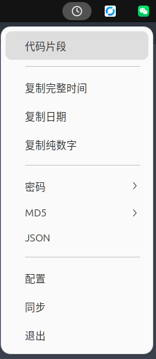
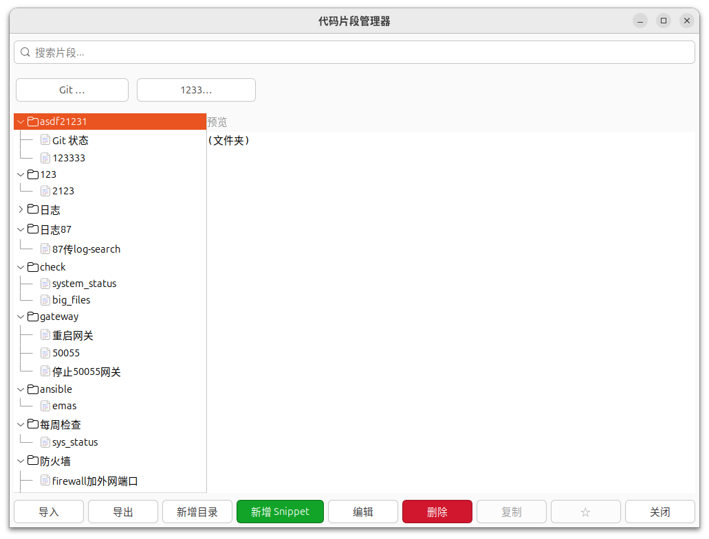

# Copy Time Tray

跨平台系统托盘时钟，点击复制当前时间到剪贴板。

支持 **Linux** 和 **Windows**。

## 功能

- 🕐 状态栏/任务栏托盘图标
- 📋 右键菜单：复制当前时间到剪贴板
- 📅 多种时间格式：完整时间 / 日期 / 纯数字
- 🔔 复制后桌面通知
- 🪟 Linux + Windows 跨平台

## 截图





## 内存占用

| 版本 | 内存 |
|------|------|
| Python | ~42 MB |
| 早期 Rust（仅托盘） | ~7 MB |

当前版本包含代码片段和 JSON 图形界面，内存占用需以实际系统、构建模式和图形后端为准；以上早期数据不代表当前版本。

## 依赖

### Linux
- `libgtk-3-dev`
- `libappindicator3-dev`

```bash
sudo apt install -y libgtk-3-dev libappindicator3-dev
```

### Windows
- 无需额外依赖（使用 tray-icon 原生 API）

## 编译

```bash
cargo build --release
```

编译产物：`target/release/copy-time-tray`

## 运行

```bash
./target/release/copy-time-tray
```

### Linux 开机自启 (systemd)

```bash
mkdir -p ~/.config/systemd/user
cat > ~/.config/systemd/user/copy-time-tray.service << EOF
[Unit]
Description=Copy Time Tray
After=graphical-session.target

[Service]
Type=simple
ExecStart=/path/to/copy-time-tray
Restart=always
RestartSec=3

[Install]
WantedBy=graphical-session.target
EOF

systemctl --user daemon-reload
systemctl --user enable --now copy-time-tray
```

### Windows 开机自启

将 `copy-time-tray.exe` 快捷方式放到：
```
%APPDATA%\Microsoft\Windows\Start Menu\Programs\Startup\
```

## 项目结构

```
copy-time-tray/
├── src/
│   └── main.rs          # 跨平台主程序（条件编译）
├── icons/
│   └── copy-time.svg    # 时钟图标（Linux）
├── Cargo.toml
└── README.md
```

## 架构

| 平台 | 托盘 | 菜单 | 事件循环 |
|------|------|------|----------|
| Linux | libappindicator | GTK | gtk::main() |
| Windows | tray-icon | muda | 托盘线程的 Win32 消息泵 + GUI 线程的单个 eframe 事件循环 |

Windows 的代码片段、JSON 和配置界面共用一个 GUI 事件循环，以独立 viewport 显示。一个透明、无任务栏图标的屏幕外宿主窗口保持消息处理，不随工具窗口关闭而销毁或重建事件循环。空闲时使用定时刷新，关闭的代码片段窗口只保留最新一次数据刷新，托盘事件队列持续消费。

Windows GUI 初始化失败（例如云服务器或远程桌面环境不满足 OpenGL 要求）时，会记录错误并自动降级为基础托盘模式，不会重复重试。复制时间、密码生成、MD5 和退出菜单仍可用；代码片段、JSON 和配置菜单禁用并标明“图形界面不可用”，托盘提示显示基础模式。修复图形环境后需重启程序才能恢复窗口功能。这是 Windows 专用的兼容降级，不改变 Linux 行为，也不代表完整支持 Windows Server 2012。

### Windows 问题排查与验证

CMD 中开启回溯（等号两侧不能加空格）：

```cmd
set "RUST_BACKTRACE=1"
copy-time-tray.exe
```

PowerShell 中使用 `$env:RUST_BACKTRACE = "1"`，再运行 `.\copy-time-tray.exe`。

```bash
cargo test --target x86_64-pc-windows-gnu
cargo test --target x86_64-pc-windows-gnu desktop_reuses_one_event_loop -- --ignored --nocapture
```

第二条是需要 Windows 桌面的集成测试，必须单独运行：检查三个工具窗口反复打开、关闭，以及预热后的 30 秒空闲工作集。Linux 下可使用 Wine/Xvfb，并设置 `CARGO_TARGET_X86_64_PC_WINDOWS_GNU_RUNNER=wine` 运行这些 Windows 测试。

## License

[GPL-3.0](LICENSE)
